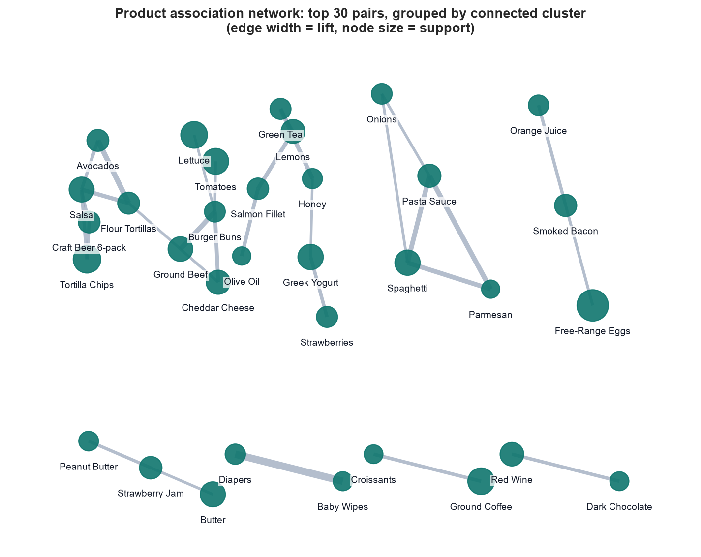
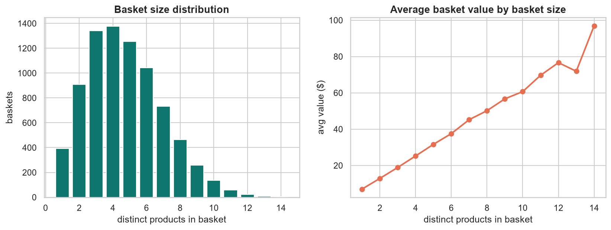
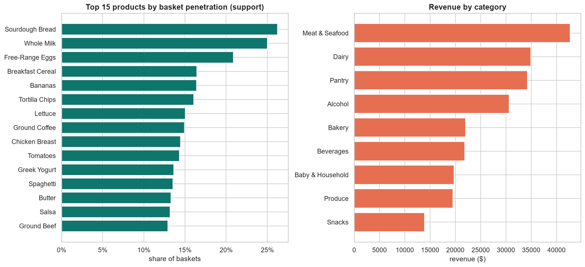
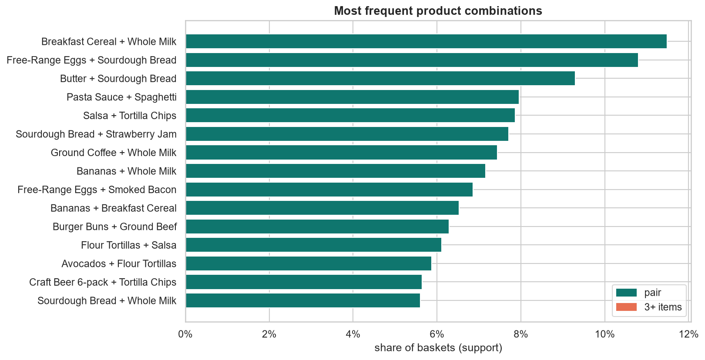
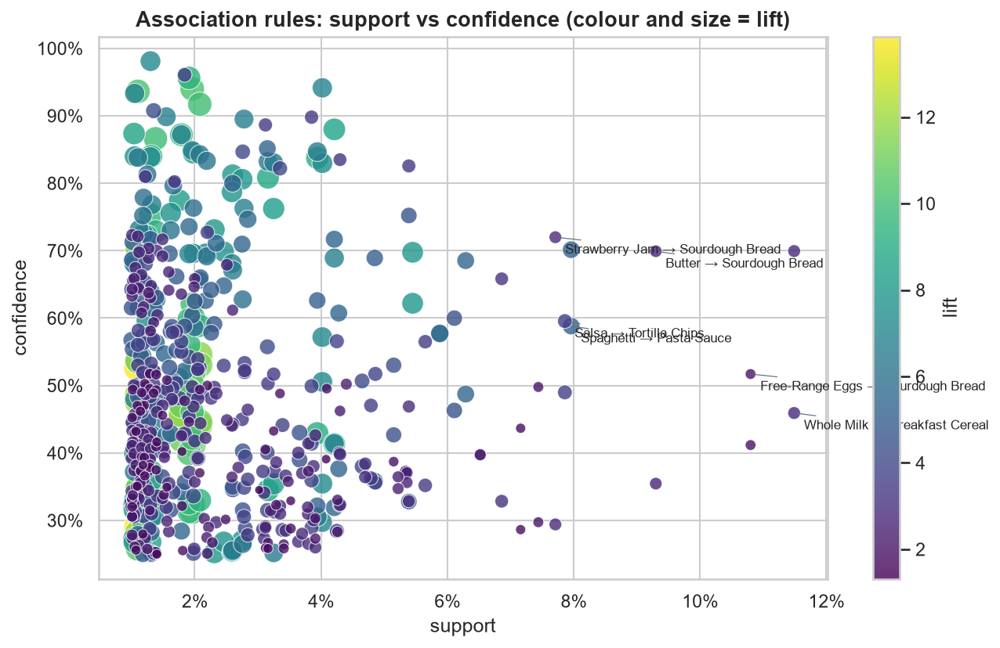
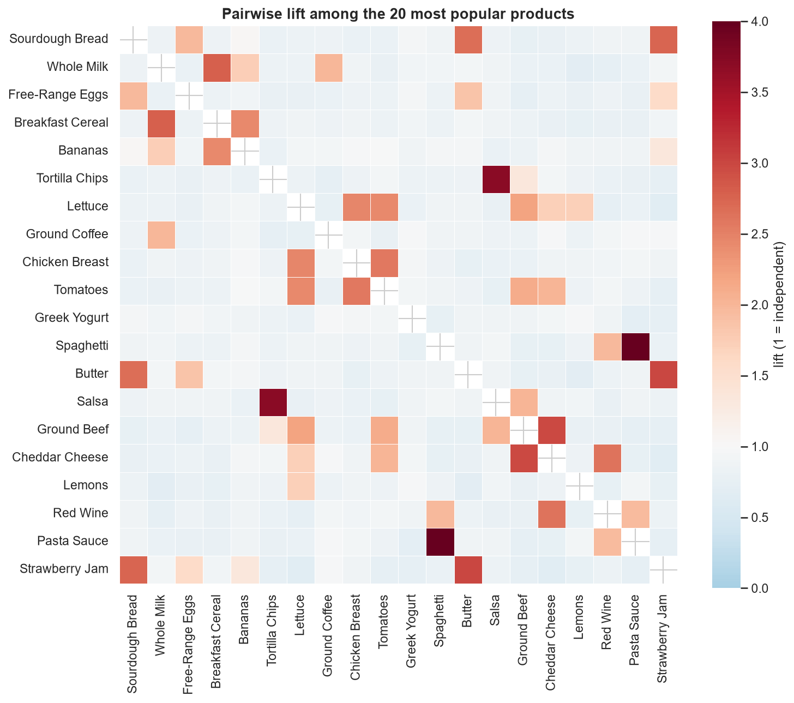

# Product Recommendation & Market Basket Analysis

Which products do grocery shoppers buy together, and how can a retailer use that to raise average order value?

This project analyses a year of point-of-sale data from **FreshCart**, a fictional three-store grocery chain (8,000 baskets, 40 products). It uses SQL and Python to clean the transactions, explore them, mine association rules with the **Apriori** algorithm, and turn the strongest rules into product placement, bundle and cross-selling recommendations.

**Tools:** Python · pandas · SQL (SQLite) · mlxtend · matplotlib · seaborn · networkx · HTML/CSS/JavaScript · d3.js

Everything runs locally: the data processing, SQL, notebook and dashboard need no internet connection or external service.



## Headline results

| | |
|---|---|
| Baskets analysed | 8,000 (from 38,652 raw line items) |
| Average order value | $29.93, with 4.7 distinct products per basket |
| Frequent itemsets (support ≥ 1%) | 613 |
| Strong rules (lift ≥ 1.2, confidence ≥ 25%) | 594 |
| SQL vs mlxtend cross-check | all 109 pair rules match to within 0.0001 |

**Top product pairs by lift**

| Rule | Support | Confidence | Lift |
|---|---|---|---|
| Baby Wipes → Diapers | 5.5% | 69.8% | 7.96 |
| Avocados → Flour Tortillas | 5.9% | 57.7% | 5.67 |
| Parmesan → Pasta Sauce | 4.3% | 60.8% | 5.35 |
| Burger Buns → Ground Beef | 6.3% | 68.5% | 5.31 |
| Pasta Sauce → Spaghetti | 8.0% | 70.2% | 5.18 |
| Honey → Green Tea | 3.7% | 43.0% | 4.58 |
| Flour Tortillas → Salsa | 6.1% | 60.0% | 4.55 |
| Salmon Fillet → Lemons | 5.2% | 53.0% | 4.40 |
| Croissants → Ground Coffee | 4.3% | 56.6% | 3.79 |
| Salsa → Tortilla Chips | 7.9% | 59.6% | 3.71 |

**Top three-item rules**

| Rule | Confidence | Lift |
|---|---|---|
| Baby Wipes + Craft Beer → Diapers | 86.6% | 9.89 |
| Cheddar Cheese + Ground Beef → Burger Buns | 83.8% | 9.13 |
| Avocados + Salsa → Flour Tortillas | 88.0% | 8.64 |

The full ranked list is in [`outputs/association_rules.csv`](outputs/association_rules.csv).

## Repository layout

```
├── data/
│   ├── raw/transactions_raw.csv        # POS export, with data-quality issues left in
│   ├── products.csv                    # product master (40 products, 9 categories)
│   ├── processed/transactions_clean.csv
│   └── DATA_DICTIONARY.md              # every column, every known data issue
├── sql/
│   ├── 01_schema_and_cleaning.sql      # tables, cleaning view, data-quality report
│   ├── 02_transaction_summaries.sql    # KPIs, basket sizes, monthly, weekday×hour, stores, customers
│   └── 03_product_analysis.sql         # product & category performance, pair support/confidence/lift
├── notebooks/
│   └── market_basket_analysis.ipynb    # cleaning → EDA → Apriori → rules → recommendations
├── outputs/
│   ├── association_rules.csv           # 594 ranked rules
│   ├── frequent_itemsets.csv
│   ├── top_product_pairs.csv
│   ├── sql_results/                    # one CSV per SQL query
│   └── figures/                        # charts used below
├── scripts/
│   ├── generate_data.py                # builds the synthetic dataset
│   ├── run_sql.py                      # loads SQLite and runs every query in sql/
│   ├── build_dashboard_data.py         # packages the results into dashboard/data.js
│   └── serve_dashboard.py              # serves the dashboard on localhost and opens a browser
├── dashboard/                          # local interactive web dashboard
│   ├── index.html
│   ├── styles.css
│   ├── app.js
│   ├── data.js                         # generated from outputs/
│   └── vendor/d3.v7.9.0.min.js         # charting library, bundled so it works offline
├── GETTING_STARTED.md                  # plain-language summary and beginner setup guide
└── requirements.txt
```

## How to run

```bash
python -m venv .venv && source .venv/bin/activate
pip install -r requirements.txt

python scripts/generate_data.py      # optional: data/ is already committed
python scripts/run_sql.py            # builds data/retail.db, writes outputs/sql_results/
jupyter nbconvert --to notebook --execute --inplace notebooks/market_basket_analysis.ipynb
python scripts/build_dashboard_data.py   # packages results for the dashboard
python scripts/serve_dashboard.py        # dashboard at http://localhost:8000
```

Run `run_sql.py` before the notebook, because the notebook reads `data/retail.db` and cross-checks its rules against the SQL output.

## Methodology

### 1. Data

The dataset is synthetic. `generate_data.py` builds each basket from zero to three shopping "missions" (pasta night, taco night, breakfast, baby supplies and so on), each including its products with set probabilities, plus random top-up items weighted by product popularity. That gives real co-purchase structure for the algorithm to recover, among plenty of noise. Weekends get 1.5× the traffic of weekdays, and 12% of checkouts are guests.

Real POS data is messy, so the raw export includes cancelled invoices, returns, scanner duplicates, zero-price test rows, and product names with the wrong case, extra spaces or no value. [`DATA_DICTIONARY.md`](data/DATA_DICTIONARY.md) lists each issue and how it is handled.

### 2. Cleaning (SQL and pandas)

The same five rules run in both the SQL view `transactions` and the notebook, so both analyse identical data:

1. Drop cancelled invoices and returns. A return is not a purchase decision.
2. Drop zero-price test rows.
3. Remove exact duplicate rows.
4. Take product names and categories from the product master, keyed on `product_id`.
5. Compute line totals.

This keeps 37,864 of 38,652 rows (98.0%), in 8,000 baskets.

### 3. Exploratory analysis

The SQL summaries cover KPIs, basket-size distribution, monthly trend, a weekday × hour profile, store comparison, customer frequency segments, product and category performance, and products most often bought on their own.





### 4. Association rule mining

Each basket becomes a row of a one-hot basket × product matrix (`mlxtend.TransactionEncoder`). Quantity is ignored, because the question is whether items appear together.

- **Apriori** finds every itemset in at least 1% of baskets (`min_support = 0.01`, or 80 baskets). This gives 613 itemsets: 40 singles, 427 pairs, 131 triples, 14 of four items and 1 of five. Moving the threshold to 0.5% roughly triples the count (1,622), and 2% cuts it to 216. At 1%, a pattern needs enough baskets behind it to be reliable but can still come from a mid-popularity product.
- **Rules** are generated from those itemsets and kept when **lift ≥ 1.2** and **confidence ≥ 25%**, then ranked by lift and then confidence.

| Metric | Formula | Meaning |
|---|---|---|
| Support | P(A ∩ B) | How common the combination is |
| Confidence | P(B \| A) | How often B follows when A is in the basket |
| Lift | P(B \| A) / P(B) | How much A raises the chance of B; 1 means no link |
| Leverage | P(A ∩ B) − P(A)P(B) | Extra co-occurrence above chance |
| Conviction | (1 − P(B)) / (1 − confidence) | How often the rule would be wrong if A and B were unrelated |

`sql/03_product_analysis.sql` computes the pair metrics independently with a self-join. All 109 pair rules match the mlxtend values to within 0.0001.







### 5. Recommender

`recommend(basket)` in the notebook looks up every rule whose antecedent is already in the basket. It returns the highest-lift consequents the basket doesn't contain yet. For a basket with only Spaghetti, it suggests Parmesan + Pasta Sauce, then Pasta Sauce, then Parmesan.

## Findings

- **The strongest associations are meal and mission kits:** pasta night, taco night, burgers, baby supplies, salmon and lemon, coffee and croissants. Their lifts run from 3.7 to 8.0.
- **Three-item rules are the most actionable.** Once two parts of a kit are in the basket, the third follows 84–88% of the time.
- **Staples make poor recommendation targets.** Breakfast Cereal → Whole Milk has 70% confidence but only 2.8 lift, because milk is already in 25% of baskets. Ranking by confidence alone would keep suggesting things people were going to buy anyway.
- **The textbook Diapers → Beer link is there but modest:** 21.5% confidence, lift 2.15. That's much weaker than Diapers ↔ Baby Wipes.
- **Few baskets hold a single item (4.9%),** so the opportunity is to add a sixth item to a five-item basket, not to turn one-item trips into two. Each extra product adds about $6 to the basket.

## Business applications

| Lever | Recommendation | Rules behind it |
|---|---|---|
| **Product placement** | Put salsa and avocados beside the tortillas, Parmesan on the pasta aisle, lemons at the fish counter and croissants by the coffee. Keep diapers and wipes in the same bay. | High-lift pairs that sit in different store sections |
| **Bundles** | *Taco Night* (tortillas + salsa + avocados), *Burger Night* (buns + beef + cheddar), *Pasta Night* (spaghetti + sauce + Parmesan), *Baby Essentials* (diapers + wipes). Discount the lower-margin item, not the anchor. | Three-item rules with confidence above 80% |
| **Cross-selling** | Use the recommender for checkout prompts, "frequently bought together" on the app, and coupons printed on the receipt. | Trigger on the antecedent, show the highest-lift item not in the basket |
| **Coupons** | Target rules with high lift but moderate confidence (Spaghetti → Parmesan, 36%), where conversion has the most room to grow. | Lift > 3, confidence 25–45% |
| **Measurement** | Run each change as an A/B test. Track average order value and attach rate (share of trigger baskets that add the suggested item). | |

## Limitations

- **Synthetic data.** The associations were planted by the generator, so these results show that the method works, not how real shoppers behave. On real data, expect weaker and noisier rules.
- **Correlation, not causation.** A high lift says two items appear together. It does not say a promotion on one will sell the other. Only an experiment can show that.
- **Thresholds are judgement calls.** Rare but valuable pairs (such as Olive Oil, at 2.8% support) are near the 1% cut-off, and a lower threshold would surface more niche rules at the cost of more noise.
- **No quantity, price or margin.** Rules treat a $1 lemon and a $12 bottle of wine the same. A production version should weight rules by margin and expected revenue.
- **No time or customer dimension.** Rules are pooled across the year, the stores and all customers. Seasonal effects, store differences and repeat-customer sequences (sequential pattern mining) are not modelled.
- **Mirror rules.** Every pair appears in both directions (A → B and B → A) with the same lift. `top_product_pairs.csv` keeps the direction with the higher confidence.

## Interactive dashboard

`dashboard/` is a static web dashboard built with plain HTML, CSS and JavaScript, with charts drawn by d3.js. Everything it needs is in the folder, including the d3 library, so it runs offline and makes no network requests.

```bash
python scripts/build_dashboard_data.py   # turns outputs/*.csv into dashboard/data.js
python scripts/serve_dashboard.py        # serves dashboard/ on http://localhost:8000 and opens your browser
```

You can also open `dashboard/index.html` directly in a browser. The data is loaded as a script, so it works without a server. The server only listens on `127.0.0.1`, so other machines can't reach it.

- **Header:** the strongest product link in one sentence, plus six headline figures.
- **Rule explorer:** sliders for minimum lift and confidence, a rule-size filter and a product search. A support × confidence scatter and a sortable rule table are linked: clicking one highlights the rule in the other. The filtered rules download as CSV.
- **Recommender:** build a basket from product chips, or pick an example such as "Taco night", and get the highest-lift suggestions. "Add to basket" chains suggestions together.
- **Association network:** a force-directed graph of product pairs above a lift threshold, coloured by category. Hover a product to see its partners, or click it to open it in the recommender.
- **Shopping patterns:** baskets by month, basket size, a weekday × hour heatmap, category revenue and top products.
- **Light and dark themes:** follows your system setting, with a toggle in the header.

After re-running the analysis, run `build_dashboard_data.py` again to refresh the dashboard.
